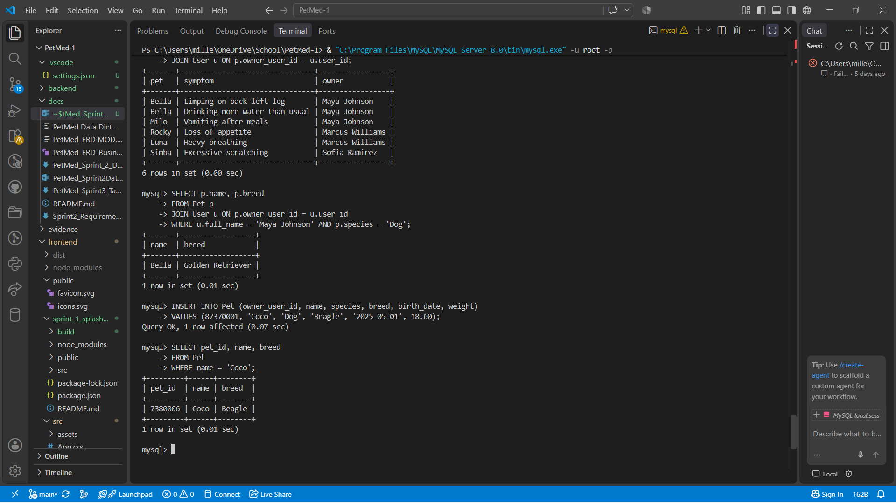
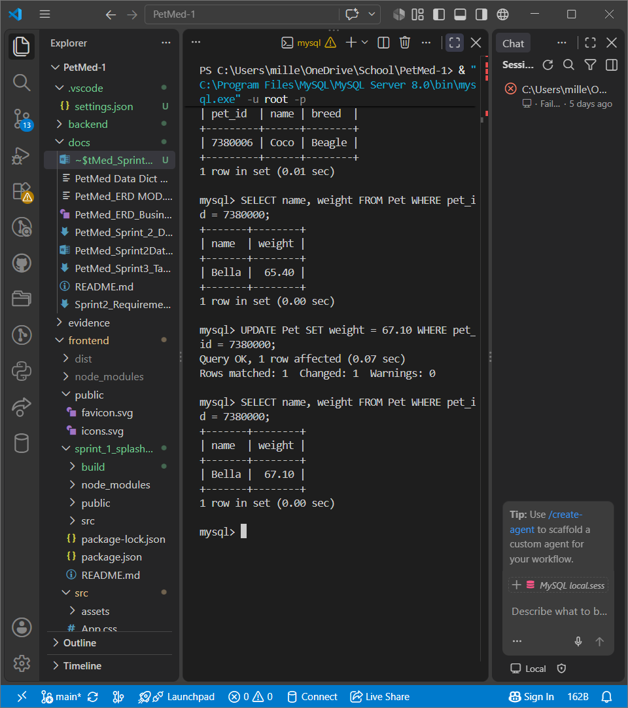

# Sprint Cycle III — Part 5: Demonstrate Database Queries

These screenshots record queries executed against the local PetMed MySQL database.
The database scripts are in [backend](../../../backend/): [schema](../../../backend/PetMedDB.sql), [sample data](../../../backend/seed.sql), and [queries](../../../backend/queries.sql).

## A–C: Retrieve/search, related data, and add data

The first screenshot demonstrates:

- **A. Retrieve/Search:** Searching Maya Johnson's dogs returns Bella, a Golden Retriever.
- **B. Related Data:** Joining symptom logs with pets and owners returns six records. The screenshot shows the final JOIN line and the resulting pet, symptom, and owner columns.
- **C. Add Data:** Inserting Coco, a Beagle owned by Marcus Williams, succeeds with one row affected. A follow-up SELECT confirms Coco has pet ID 7380006.

## D: Modify data

The second screenshot demonstrates Bella's weight before and after an UPDATE:

- Before: **65.40**.
- UPDATE: **one row matched, one row changed, zero warnings**.
- After: **67.10**.

## E: Instructor query

The instructor-requested query is a live presentation requirement. These screenshots provide evidence for A–D; they do not complete E in advance.
