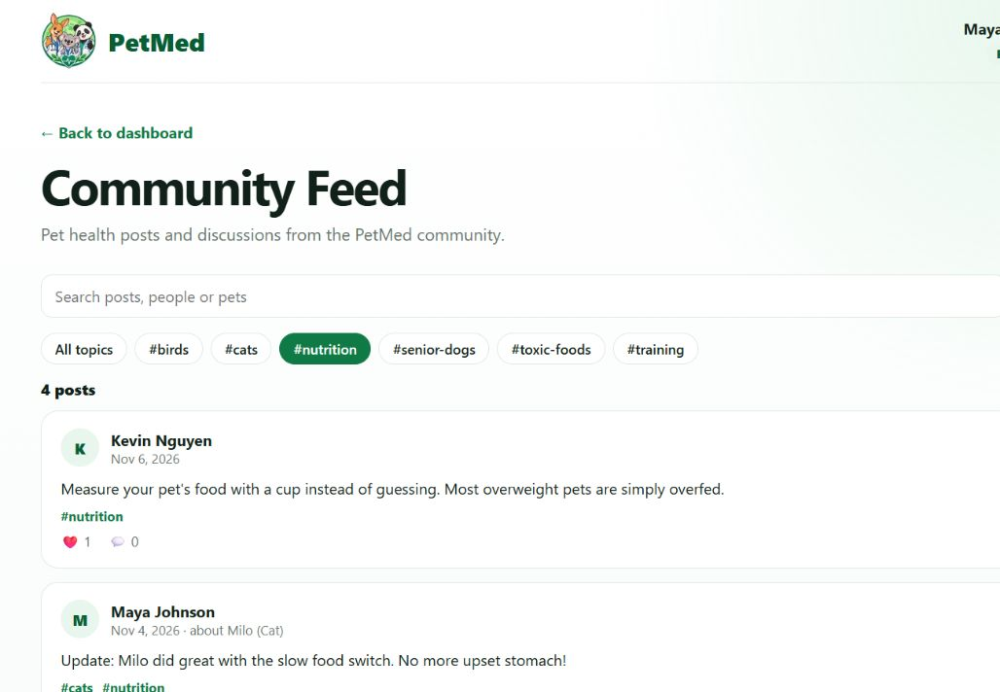
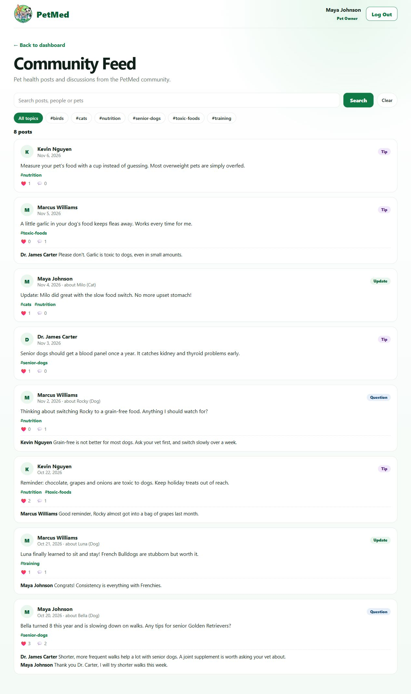

# Miles Sharpton — Sprint IV Community Feed

Verified locally on November 15, 2026, following [Miles's assigned task](../../docs/Sprint4_Team_Tasks.md).

## Completed contribution

- Added a **Clear** button beside Search on the Pet Owner Community Feed.
- Clear resets the search input, submitted search, and selected topic.
- Enabled the existing database sign-in path (`USE_TEST_USERS = false`), a shared prerequisite for receiving a valid API token and loading the real feed.
- Pulled the team's current code before making the contribution.

## Browser verification with the real MySQL database

Signed in as the sample Pet Owner, Maya Johnson, through the Python API:

1. Community Feed initially displayed **8 posts**.
2. Selected **#nutrition**: **4 posts**.
3. Clicked **Clear**: **8 posts**, All topics selected.
4. Searched **garlic**: **1 post**.
5. Clicked **Clear**: the search input emptied and **8 posts** returned.

### Nutrition filter: four posts

### Running app after Clear: eight posts

## Automated verification

- `npm.cmd run build` in `frontend`: passed.
- ESLint on the two changed JavaScript files (`CommunityFeed.jsx`, `authApi.js`): passed.
- `.venv\Scripts\python.exe -m pytest tests -v`: **23 passed, 35 subtests passed** against local MySQL.
- Full `npm.cmd run lint`: found an existing `react-refresh/only-export-components` error at `frontend/src/auth/AuthContext.jsx:43`, where `useAuth` is exported alongside a component. That file was not changed for this task.

## Miles's presentation steps

Sign in as Maya, open Community Feed, select #nutrition, and click Clear. Explain that Clear resets all three frontend filter states, triggering a fresh request to `/api/feed` for all published posts. Also demonstrate searching for garlic and clearing the search.

The API and frontend run separately: start `.venv\Scripts\python.exe src/app.py` from the repository root, and `npm.cmd run dev` from `frontend`. Local MySQL credentials remain in ignored `src/.env`.
